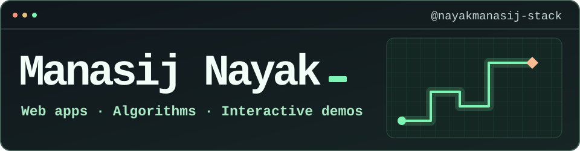
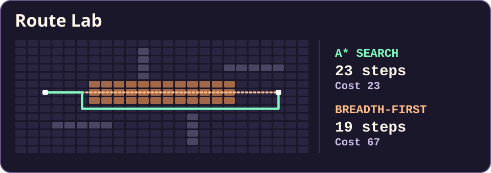
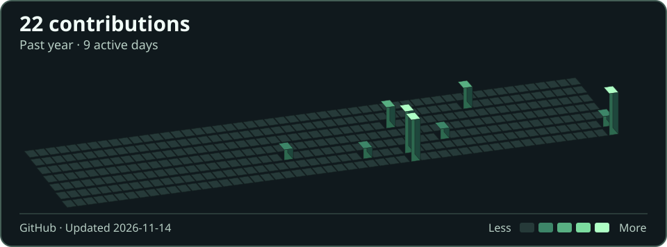

  

  

  <a href="#user-content-selected-projects">Projects</a> · <a href="#user-content-from-the-lab">From the lab</a> · <a href="#user-content-contributions">Contributions</a>

## About

I'm Manasij Nayak. I build web applications and explore how user interfaces, APIs, and databases work together. CampusKArt is my marketplace for SRM students, built with JavaScript and Supabase. I'm also exploring the React, Express, and MongoDB stack through SRM Market.

I also build interactive demos to explore computer science concepts. Route Lab compares pathfinding algorithms and shows how terrain cost can change the best route.

## Selected projects

**CampusKArt** helps SRM students buy and sell on campus. [Live demo](https://campus-k-art.vercel.app) · [Source code](https://github.com/nayakmanasij-stack/CampusKArt)

**SRM Market** is an early prototype with a React starter, an Express API, and a MongoDB connection. [Source code](https://github.com/nayakmanasij-stack/srm-market)

## From the lab

<picture>
  
</picture>

**Route Lab** is an interactive pathfinding experiment. Edit a map and compare how A*, Dijkstra, and breadth-first search trade off fewer steps against lower terrain cost.

## `~/toolbox`

## Contributions

[Browse all repositories](https://github.com/nayakmanasij-stack?tab=repositories)
