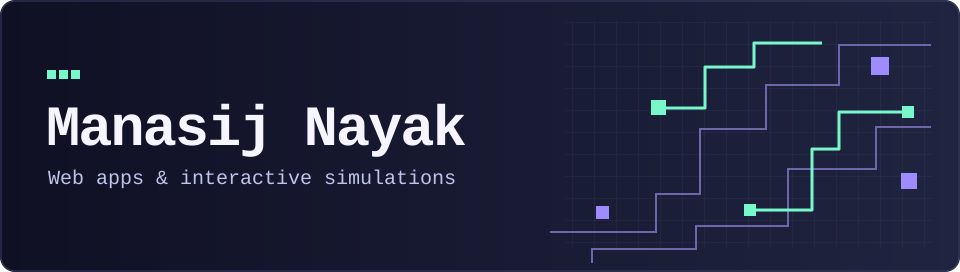
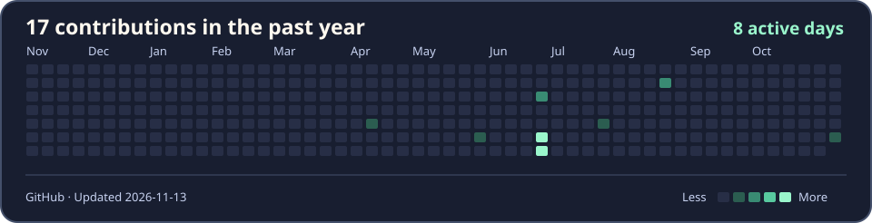

<picture>
  
</picture>

### Hi, I’m Manasij.

I build web apps and interactive demos. My public work includes a marketplace for SRM students and experiments that make technical ideas easier to explore.

### Selected work

| Project | What it does | Links |
| --- | --- | --- |
| **CampusKArt** | Campus marketplace for SRM students | [Source](https://github.com/nayakmanasij-stack/CampusKArt) · [Live demo](https://campus-k-art.vercel.app) |
| **SRM Market** | Another take on a marketplace for the SRM campus | [Source](https://github.com/nayakmanasij-stack/srm-market) |

### Tech stack

### GitHub activity

[All repositories](https://github.com/nayakmanasij-stack?tab=repositories)
