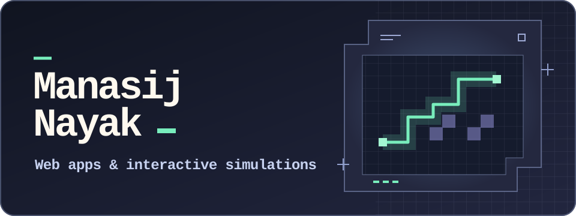

I’m Manasij. I build web apps for campus life and interactive demos that let you see how algorithms work.

[Explore my repositories ↗](https://github.com/nayakmanasij-stack?tab=repositories)

## Featured projects

**CampusKArt** gives SRM students a dedicated place to buy and sell on campus. [Try the live demo ↗](https://campus-k-art.vercel.app) · [View source](https://github.com/nayakmanasij-stack/CampusKArt)

**SRM Market** explores the same idea with a React client, an Express API, and MongoDB. [View source](https://github.com/nayakmanasij-stack/srm-market)

## Wednesday builds

**Next up · Route Lab** — edit a grid and watch A*, Dijkstra, and breadth-first search find their way through. On the same map, a route can take fewer steps and still cost more.

New projects built with Codex are scheduled for Wednesdays at 11 PM IST.

## Tech stack

## GitHub activity

