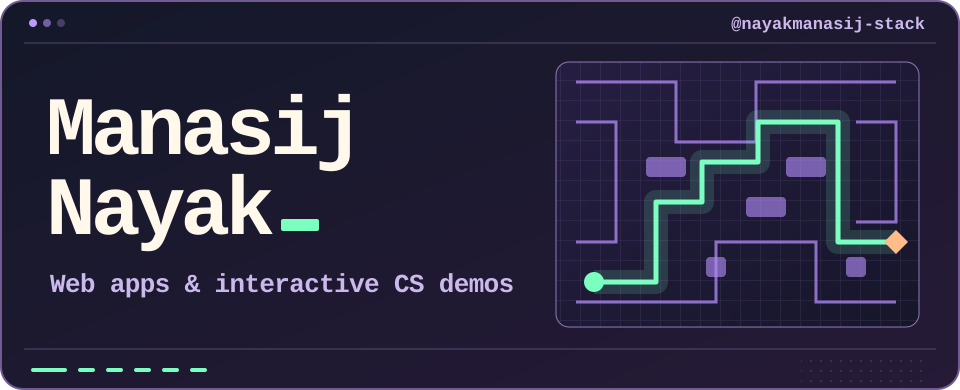

<picture>
  
</picture>

I build web apps for campus life and interactive demos that let you see how algorithms work.

## From the lab

<picture>
  
</picture>

**Next up · Route Lab** is an interactive playground for A*, Dijkstra, and breadth-first search. Add obstacles and rough terrain, then watch each algorithm tackle the same map.

New builds with Codex are scheduled for Wednesdays at 11 PM IST.

## Selected projects

**CampusKArt** gives SRM students a dedicated place to buy and sell on campus. [Live demo ↗](https://campus-k-art.vercel.app) · [Source code](https://github.com/nayakmanasij-stack/CampusKArt)

**SRM Market** uses React, Express, and MongoDB to build a campus marketplace. [Source code](https://github.com/nayakmanasij-stack/srm-market)

## Tech stack

## GitHub activity

[Browse all repositories ↗](https://github.com/nayakmanasij-stack?tab=repositories)
